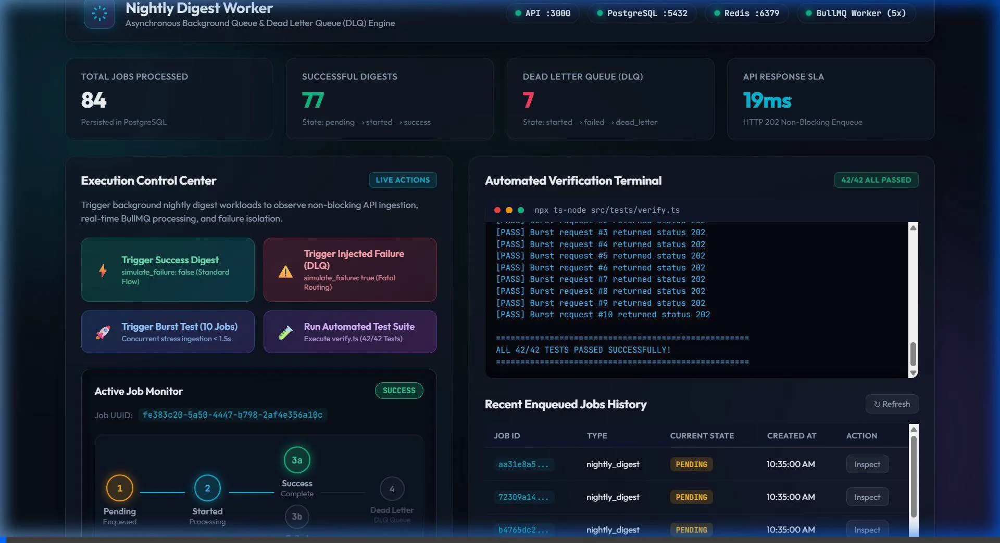
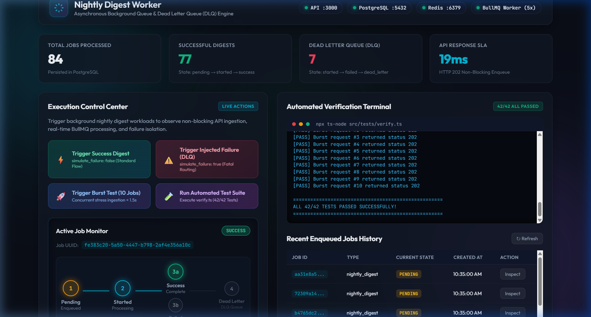
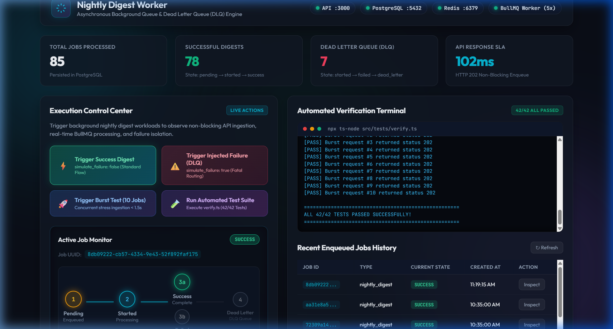
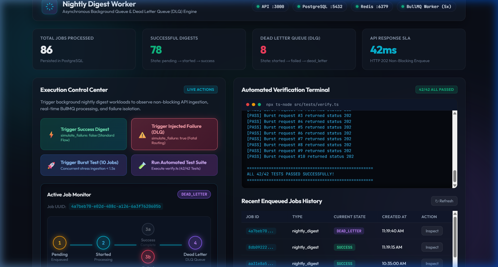
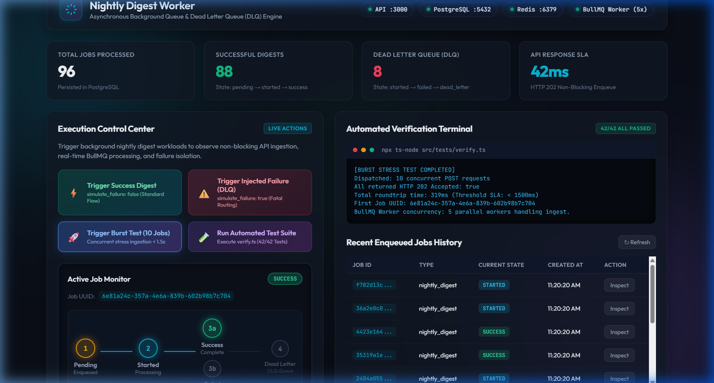

# Asynchronous Nightly Digest Worker with Activity Logging

A production-ready scheduled background worker system that orchestrates a nightly data digest, tracks execution states via a detailed immutable activity log, and reliably handles injected failures routing to a Dead Letter Queue (DLQ).

---

## 🎬 Live Demo & Visual Walkthrough



<details>
<summary>📸 View Execution Stages & State Transitions (Click to Expand)</summary>

| Dashboard Overview | Success State Machine |
|---|---|
|  |  |

| DLQ Failure Routing | Concurrency Burst & Tests (42/42 Passed) |
|---|---|
|  |  |

</details>

---

## Architecture Overview

```
                      +-----------------------------+
                      |         Trigger Layer       |
                      |  [Native Cron] [POST /API]  |
                      +--------------+--------------+
                                     |
                                     v
                      +-----------------------------+
                      |     Orchestration Layer     |
                      |   BullMQ on Redis (Queue)   |
                      +--------------+--------------+
                                     |
                                     v
                      +-----------------------------+
                      |       Execution Layer       |
                      |      Background Worker      |
                      +--------------+--------------+
                                     |
                      +--------------+--------------+
                      |                             |
                 [On Success]                  [On Failure]
                      |                             |
                      v                             v
           +--------------------+         +--------------------+
           |  Mark as 'success' |         |  Mark as 'failed'  |
           +--------------------+         +---------+----------+
                                                    |
                                                    v
                                          +--------------------+
                                          | Route to BullMQ DLQ|
                                          | Mark 'dead_letter' |
                                          +--------------------+
```

All state transitions and job records are persisted to a PostgreSQL database with relational integrity and strict chronological ordering.

---

## State Machine & Transitions

1. **Job Enqueued**:
   - Initial entry in `jobs` table.
   - Initial entry in `job_activity_logs` with state `pending`.
2. **Success Flow** (`simulate_failure: false`):
   - Worker picks up job: records state `started`.
   - Worker performs workload simulation (2s delay).
   - Worker records state `success`.
   - State sequence: `pending` -> `started` -> `success`.
3. **Failure & Dead Letter Flow** (`simulate_failure: true`):
   - Worker picks up job: records state `started`.
   - Injected failure triggered: records state `failed`.
   - Worker moves job to DLQ: records state `dead_letter`.
   - State sequence: `pending` -> `started` -> `failed` -> `dead_letter`.

---

## Database Schema

### Table: `jobs`
| Column | Type | Constraints | Description |
|---|---|---|---|
| `id` | `UUID` | `PRIMARY KEY` | Unique job identifier |
| `name` | `VARCHAR(255)` | `NOT NULL` | Job type identifier (`nightly_digest`) |
| `payload` | `JSONB` | `NULLABLE` | Input parameters for job execution |
| `created_at` | `TIMESTAMP` | `DEFAULT NOW()` | Job creation timestamp |

### Table: `job_activity_logs`
| Column | Type | Constraints | Description |
|---|---|---|---|
| `id` | `UUID` | `PRIMARY KEY` | Unique log identifier |
| `job_id` | `UUID` | `FOREIGN KEY (jobs.id) ON DELETE CASCADE` | Reference to parent job |
| `state` | `VARCHAR(50)` | `NOT NULL` | State name (`pending`, `started`, `success`, `failed`, `dead_letter`) |
| `message` | `TEXT` | `NULLABLE` | Contextual information or error string |
| `created_at` | `TIMESTAMP` | `DEFAULT NOW()` | State transition timestamp |

---

## API Endpoints

### 1. Enqueue Job
`POST /api/jobs/trigger`

**Request Body**:
```json
{
  "type": "nightly_digest",
  "simulate_failure": false
}
```

**Response** (`202 Accepted`):
```json
{
  "job_id": "9b1deb4d-3b7d-4bad-9bdd-2b0d7b3dcb6d",
  "message": "Job accepted for processing"
}
```

### 2. Retrieve Job History & State
`GET /api/jobs/{job_id}/logs`

**Response** (`200 OK`):
```json
{
  "job_id": "9b1deb4d-3b7d-4bad-9bdd-2b0d7b3dcb6d",
  "current_state": "success",
  "logs": [
    {
      "state": "pending",
      "message": "Job created via API trigger",
      "created_at": "2026-10-03T14:10:00.000Z"
    },
    {
      "state": "started",
      "message": "Worker picked up job",
      "created_at": "2026-10-03T14:10:00.050Z"
    },
    {
      "state": "success",
      "message": "Digest generated successfully",
      "created_at": "2026-10-03T14:10:02.055Z"
    }
  ]
}
```

---

## Running with Docker Compose

Start the full stack (API, Worker, PostgreSQL, Redis) with automated database initialization:

```bash
docker-compose up -d --build
```

Check health status of all services:

```bash
docker-compose ps
```

Stop the stack:

```bash
docker-compose down
```
